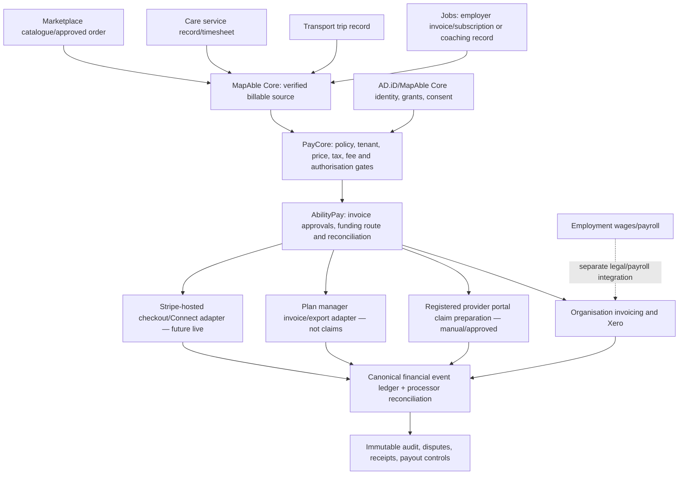

# MapAble PayCore — Centralised Payment Orchestration Architecture v0.1

**Date:** 31 October 2026
**Status:** Draft technical design and preparation-only test contract; **no live financial execution**.
**Owner:** Australian Disability Ltd / MapAble; accountable engineering, finance, privacy and regulatory reviewers to be assigned.
**Repo baseline:** ausdisau/mapableau-new main @ 4a50f790fc4ada4e037b4dd2d1812d1e40f37c53.
**Related draft PRs:** #641 Inclusive Marketplace and #642 supplier-to-refund assurance lab. Keep their feature gates unchanged and do not merge them implicitly.

## Decision

Build one shared financial control plane across Marketplace, Care, Transport and Jobs, reusing existing MapAble Billing Core and AbilityPay. **MapAble Core** owns source records, NDIS/service policy and approvals; **AbilityPay** owns invoice review, financial coordination, plan-manager export preparation and deterministic reconciliation; **Stripe** is an optional external PSP for suitable private/self-managed card transactions and reviewed Connect payouts; **Xero** handles formal accounting and invoice sync. **Payroll wages and employment entitlements are not ordinary marketplace payouts**.

Phase 1 is an orchestrator and evidence ledger, **not** custody of participant funds, stored value, PayTo/NPP access, financial advice or a registered plan-management service.

## Current implementation evidence

- `prisma/schema.prisma`: BillingInvoice, BillingPayment, BillingPaymentSplit, BillingFundingSource, BillingAccount, PayoutRecipient, PayoutTransfer, PaymentAllocation and other records.
- `lib/billing/core/checkout-service.ts`: Stripe Checkout initiation from existing invoice totals; potential single-provider Connect destination.
- `lib/billing/core/funding-logic.ts`: self-managed/private card can use hosted payment; plan-managed invoices export; other funding blocks.
- `lib/billing/service-records/service.ts`: evidence-backed source records and draft-invoice workflow.
- `lib/abilitypay/abilitypay-service.ts`: deterministic invoice reconciliation and participant review; payment execution disabled.
- `lib/config/abilitypay-home-living.ts`: `paymentExecutionEnabled: false` and `ndisClaimSubmissionEnabled: false`.
- `lib/billing/payment-reconciliation/reconciliation-service.ts`: separate older invoice/Stripe/Xero comparison service. This is NOT itself a proof of settlement.
- `docs/abilitypay-architecture.md` and `docs/careos-financial-boundaries.md`: participant authority and financial decision boundaries.

**Material gaps found**:
1. Generic `POST /api/billing/invoices` accepts user-supplied descriptions, quantities, rates, GST and line metadata. Source-verified invoice construction must replace this for all four verticals; draft PR #641 proposes only a Marketplace-specific guard.
2. `createCheckoutForInvoice` can create BillingPayment and Checkout sessions from invoice totals; inspect invoice ownership, statuses, verification, idempotency, and concurrent request semantics before wider deployment.
3. In `lib/stripe/webhooks.ts`, per-handler exceptions are caught and the corresponding webhook event can still be marked processed. A successfully acknowledged but failed handler may not be retried by the processor. This requires targeted remediation and replay tests.
4. `assertLivemodeMatches` in `lib/billing/core/webhook-handler.ts` logs a warning on mismatch rather than rejecting it. This must be treated as a release blocker for financial processing.
5. Payments, payouts, customer invoices, accounting, AbilityPay and older reconciliation models overlap. Establish canonical event ownership, uniqueness and financial state before adding more service-specific payment tables.

## Architecture (logical, not a live service topology)

All payment, transfer and claim rails are **disabled in this design slice**. The diagram describes future interfaces and boundaries, not approved operational integrations.

## Contract and API boundaries

1. Each domain sends an opaque source reference: `{vertical,sourceType,sourceId,version,organisationId}`. **No client unit prices, GST claims, NDIS support code guesses, personal health details or untrusted vendor payout instructions.**
2. PayCore loads the canonical source and checks tenant, participant authority, contract, service/supplier evidence, pricing revision, tax review, fee disclosure, dispute holds, and cancellation state.
3. AbilityPay presents a readable, accessible itemised statement and recorded participant/organisation choice. A carer or coordinator may prepare only with a purpose-bound, unexpired, revocable participant authorisation.
4. Funding router chooses a **nonexecuting preparation path**:
   - `private_card`, `private_pay`: hosted PSP preparation for approved participant purchases, employer subscriptions or organisational Marketplace purchases, not live capture;
   - `ndis_self_managed`: private/card route and receipt, with independent NDIS claim/reimbursement by participant; no auto-eligibility;
   - `ndis_plan_managed`: invoice to registered plan manager; **no card capture**;
   - `ndis_agency_managed`: eligible registered provider's approved NDIA portal route, not a card transaction or implied direct NDIS API;
   - `employer_funded`, `organisation_invoice`: organisation receivable/invoice route;
   - `mixed`, grant and other unresolved funding: human review before defining separate independent funding legs.
5. When and only when independently authorised, a payment adapter could create a **server-idempotent** Stripe session or approved alternate PSP request; provider responses are not financial truth until verified against signed webhook and settlement records.
6. Processor/bank reconciliation and accounting postings are transactionally linked by durable idempotency keys, payment intent and source version, not by amounts alone.
7. Refunds, disputes, chargebacks and cancellations are explicit casework with participant-facing explanation and accessible human escalation. Freeze payout on unresolved problems.
8. Payout release requires verifiable recipient onboarding, settled funding, contract attestation, no unresolved dispute, eligibility of the payment model and finance approval. No automatic release in the first phase.

### Proposed persistent schema additions (NOT implemented in this PR)

- `BillingSourceCharge` unique on `(organisationId,sourceType,sourceId,version)`.
- `PaymentCommand` unique on `(organisationId,idempotencyKey)` and immutable approved amount + consent receipt.
- `PaymentProcessorEvent` unique on `(provider,eventId)` with `pending,processing,processed,failed`, processing lock, retries and dead-letter.
- `PaymentJournalEntry` in balanced debit/credit pairs, typed accounts, immutable reference and correction entries; invoice and PSP clearing distinguished from actual bank balance.
- `PaymentReconciliationRecord` for settlement files, fees, chargebacks, payout and refund allocation; differences require manual review.
- `PaymentMandate` for third-party approvals and legal authority with scope, revocation and expiry (do not conflate with Core consent).
- `MerchantContract`, `PayoutRecipient` and a policy-versioned `PayoutHold` for settlement liability, insurance and KYC.
- Read-only `AbilityPayPlanManagerAdapter`, `StripePaymentsAdapter`, `XeroAccountingAdapter` and future `SponsoredPayToAdapter` behind capability and regulatory gates.

Review current Prisma models before creating any of these to avoid duplicates. Use additive migrations, unique DB constraints and transactional invariants.

## Service-specific commercial rules

| Service | Billing source | Authorisation | Route | Important restriction |
| --- | --- | --- | --- | --- |
| Marketplace | seller contract, item/order, evidence and stock | buyer confirms price and terms | card/PSP or reviewed invoice | No checkout for unsafe/unverified products, cannot infer NDIS funding |
| Care | confirmed shift, worker time and service agreement | participant review / purpose-bound consent | private/self-pay, plan-manager export, or registered-provider claim preparation | Evidence-driven rates; missed shift and cancellation require separate treatment |
| Transport | agreed trip, actual journey evidence and authorised fare changes | rider review or lawful scoped authority | private card or appropriate plan-manager/provider route | No automatic surcharge for a delay; service mismatch and no-show disputes |
| Jobs | employer subscription, training, recruitment or approved coaching | organisation contract approval or participant for own service | B2B invoice / hosted PSP | Wages, PAYG, super, payroll, payslips and unlawful worker deductions are OUT OF SCOPE |

**Cross-vertical journeys** should show one consolidated statement and allow different payers. The backend must split each funding rail into its own invoice/payment instruction. Never bundle a plan-managed service and a private purchase into a single undifferentiated Stripe charge.

## Payment methods and economic options

Stripe Connect offers direct, destination, and separate charge-and-transfer models. Liability for refunds, disputes, fees, merchant-of-record and cross-border obligations differs. Select charge mode per legal relationship and merchant agreements, **not simply per service feature**. Prefer direct charges or merchant-of-record clarity for a single independent seller when contractual facts permit; multi-party carts may require separately reviewed separate-charge-and-transfer economics. No charge mode or platform percentage is preapproved.

Avoid a MapAble-branded wallet, stored value, custodial escrow or direct unsponsored bank-rail access. Prioritise a licensed PSP with hosted payment-page scope. PayTo/NPP would require licensed/sponsored rail access, mandates, consent and dispute controls, and separate legal validation.

**Platform fees** must be itemised and cannot be hidden inside approved NDIS support rates or deducted unlawfully from employment wages. GST is product/service- and agreement-specific; it cannot be inferred merely from NDIS participant status. Audit of fees and fee payers must be independent of access advocacy ratings.

## Security controls, events and observability

- Authorisation: authenticated user and organisation-scoped membership, purpose-specific participant consent, delegation scopes, step-up MFA for irreversible payment actions, explicit buyer consent.
- Request trust: opaque source IDs and quantities only; charge amounts constructed server-side from verified versioned records. Fail closed on mismatch, cancelled service or out-of-date quote.
- Idempotency: immutable idempotency key per command within tenant, DB uniqueness, processor key, replay test. No PII in keys or Stripe metadata.
- Webhooks: raw body signature verification, environment mismatch rejection, unique event store, process/ack separation, reliable retry and dead-letter; Stripe sends asynchronous and potentially repeated events.
- Persistence: atomic source lock/invoice + ledger/outbox creation where possible; worker processing to PSP not in DB transaction. Canonical audit events append, corrections via adjustment entries.
- Payout: product/service acceptance and consent evidence, recipient capability, payout holds, balance and fee reconciliation. Do not make transfers merely when a browser reports checkout success.
- Privacy: no plan IDs, clinical diagnosis, AAC profile or detailed disability context in processor metadata; only opaque financial references.
- Operations: daily PSP-to-bank-to-ledger comparison, ageing of unreconciled transactions, payout failure and refund/chargeback monitoring, incident and participant support.
- Finance: GST/ATO review, no unlicensed custody/credit, annual audits, independent accounting review.

## Participant accessibility and service recovery

WCAG 2.2 AA target; screen-reader and keyboard-complete payment decisions; AAC and switch access; 200–400% zoom; clear non-colour error status; non-time-pressured confirmation with review/cancel; plain-language account and invoice descriptions; accessible downloadable receipts; contact by text/email/phone depending on participant preference; human dispute escalation. Do not require a family member or nominee to access payment information when the participant can choose independently.

## Blocking legal checks (not approvals)

- ASIC RG 185 / potential non-cash payment facility licensing if operating funds, stored value or remittance arrangements change.
- NDIS Commission in-scope digital platform requirements effective 1 July 2026; formally classify the exact planned service and registration status before NDIS-funded Care/other payments.
- NDIA rules differentiate self-managed, plan-managed and NDIA-managed provider payments; no blanket card checkout and no implied NDIA API permission.
- ACCC/ACL requirements for customer refunds, responsibilities and seller identity.
- Fair Work payroll and wage protections for Jobs employment vs fee-based services.
- OAIC data minimisation and access controls; PCI DSS hosted payment-page scope and independent assessor review.

## Test and progressive release plan

P0: Reconcile legacy billing and AbilityPay models; identify one authoritative source record, record dual-path conflicts, audit current webhook handling and stripe livemode mismatches; add negative/replay tests; keep execution off.
P1: Unit-tested cross-vertical prepare-only funding router in `lib/billing/orchestration/paycore-policy.ts`. This PR does **only** P1 contracts and tests; no route or Prisma migration.
P2: Server-only quote/orchestration API built from typed source IDs, participant approval receipts and versioned pricing; signed/verified preview endpoints (synthetic first); no payment capture.
P3: Accounting/Xero and plan-manager export adapters with manual verification and linked evidence; never auto-claim.
P4: Stripe hosted checkout behind explicit environment and recipient gates; signed webhook retry/settlement; legally reviewed Connect transfer mode.
P5: Operations hardening, full incident/complaints/returns, nightly reconciliation, formal compliance/financial audit, disability-led usability and accessibility acceptance.

**Stop condition:** No production payment, payout or NDIA claim activation until all P0 critical defects, licensing, seller responsibility, processor contract, data protection, support operations and independent review are demonstrably complete.

## Source links

- Repo: https://github.com/ausdisau/mapableau-new
- AbilityPay: https://github.com/ausdisau/mapableau-new/blob/main/lib/abilitypay/abilitypay-service.ts
- AbilityPay architecture: https://github.com/ausdisau/mapableau-new/blob/main/docs/abilitypay-architecture.md
- MapAble Billing: https://github.com/ausdisau/mapableau-new/blob/main/docs/billing.md
- Stripe Connect: https://docs.stripe.com/connect/charges
- Stripe webhook guidance: https://docs.stripe.com/webhooks
- Stripe idempotency: https://docs.stripe.com/api/idempotent_requests
- NDIS payments: https://www.ndis.gov.au/providers/pricing-and-payments/payments/guide-getting-paid
- NDIS platform regulation: https://www.ndiscommission.gov.au/about-us/ndis-commission-reform-hub/mandatory-registration
- ASIC payment licensing: https://www.asic.gov.au/regulatory-resources/find-a-document/regulatory-guides/rg-185-non-cash-payment-facilities
- Fair Work: https://www.fairwork.gov.au/pay-and-wages/paying-wages
- ATO GST-free NDIS supply requirements: https://www.ato.gov.au/api/public/content/0-2a504f7a-e122-4f57-9a24-5a839c5975a1
- OAIC APP guidelines: https://www.oaic.gov.au/privacy/australian-privacy-principles/australian-privacy-principles-guidelines
- PCI SSC hosted payment page: https://www.pcisecuritystandards.org/faqs/if-a-merchant-s-e-commerce-implementation-meets-the-criteria-that-all-elements-of-payment-pages-originate-from-a-pci-dss-compliant-service-provider-is-the-merchant-eligible-to-complete-saq-a-or-saq-a-ep/

## Release decision

**Technical architecture is ready for review as a design and pure TypeScript policy contract. No live functionality is unlocked by this PR. Do not merge or deploy without explicit human approval.**
