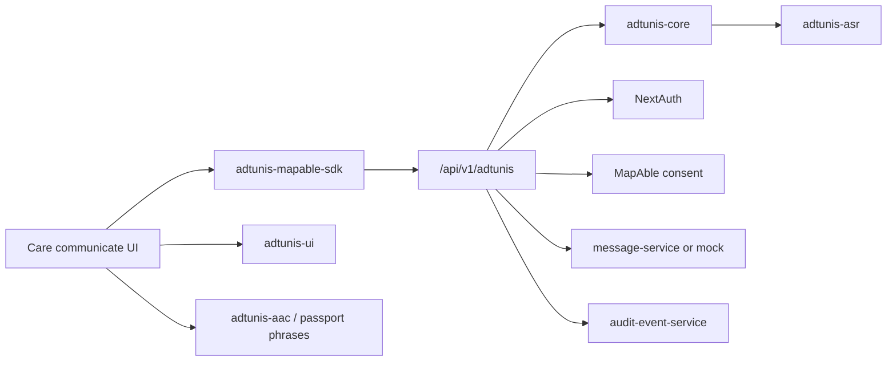

# ADR: Adtunis communication layer inside MapAble

## Status

Accepted for vertical-slice implementation on `mapableau-new` (2026-11-03, Australia/Sydney).

## Context

Adtunis already exists as a participant-controlled speech/personalisation demo (uploaded workspace) with immutable raw recognition, independent consents, fail-closed ASR, and a native bridge. MapAble Core already provides NextAuth identity, consent records, audit events, messaging, and an AAC communication passport. Introducing Clerk or a second consent ledger would compete with MapAble Core.

## Decision

1. Port Adtunis **domain** (state machine, provider contracts, bridge types, Care composer UX) into `packages/adtunis-*`.
2. Mount APIs under MapAble `app/api/v1/adtunis/*` with NextAuth session isolation (`participantId` = MapAble user id).
3. Map Adtunis transcription / personalisation / research / audio-retention choices onto MapAble `ConsentScope` values; MapAble `ConsentRecord` is authoritative.
4. Deliver confirmed Care expressions through MapAble `message-service` or a clearly labelled mock adapter.
5. Keep ASR fail-closed / simulated unless approved private self-hosted config is present.
6. Do not vendor Adtunis Clerk, DiverseSpeechEngine Express/Drizzle, or Aditunis Firebase.

## Consequences

- Care participants can compose via speech (when available), typing, or AAC without making voice mandatory.
- Model Lab / cloud vendor enablement remains simulation-only until policy approval.
- Later port path: copy packages + routes into `ausdisau/MapAble` `apps/web`.

## System diagram

